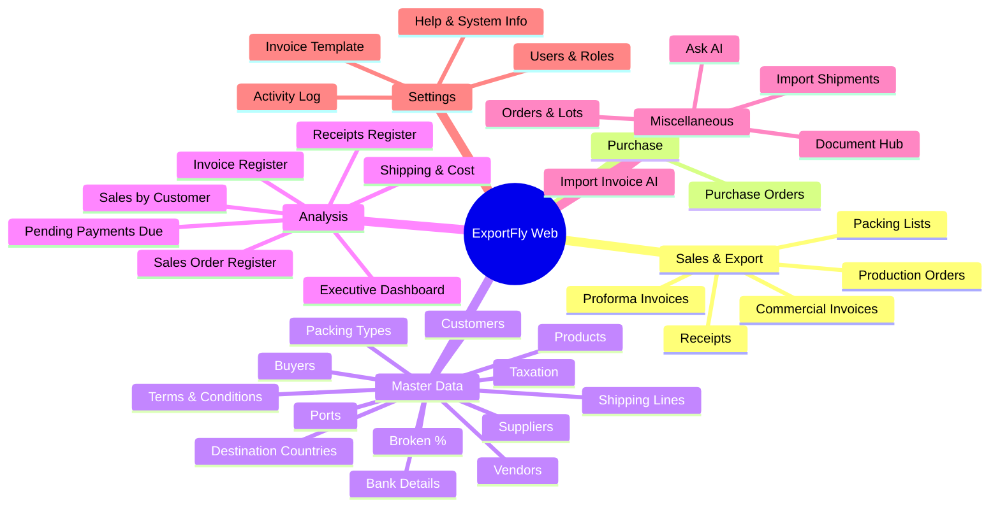

# ExportFly Web — Module Map & Screen Hierarchy

ExportFly organizes all business functions into a predictable navigation hierarchy matching the desktop application workflow.

---

## Screen & Module Catalog

| Group | Module / Screen | Primary Purpose | Authorization Scope |
| :--- | :--- | :--- | :--- |
| **Sales & Export** | Proforma Invoices (PI) | Formal quotations to foreign buyers with Incoterm & packing specs | Sales, Accounts, Admin |
| | Production Orders (PO) | Work instructions dispatched to the rice mill for milling/packing (no prices) | Production, Admin |
| | Commercial Invoices | Authoritative export invoice for customs, bank LC negotiation & billing | Accounts, Admin |
| | Packing Lists | Container-level breakdown with seal numbers, gross/net weights, and bag counts | Logistics, Accounts, Admin |
| | Receipts | Payment tracking against invoices with bank allocation | Accounts, Admin |
| **Purchase** | Purchase Orders | Raw material/paddy/packaging purchase records cross-checked with mill intake | Purchase, Admin |
| **Master Data** | Customers & Buyers | Consignees, Notify Parties, and Foreign Buyers master directory | All Authenticated Users |
| | Products | Rice varieties (1121, 1509, Sugandha, Sharbati, PR11), HSN codes, and base specs | All Authenticated Users |
| | Suppliers & Vendors | Rice mills, bag manufacturers, fumigation agencies, transport vendors | All Authenticated Users |
| | Broken % Masters | Specification tiers (1%, 2%, 5%, 10% broken grains) | All Authenticated Users |
| | Packing Types | Standard bags (10kg, 20kg, 25kg, 30kg, 40kg, 50kg in BOPP, Non-Woven, Jute) | All Authenticated Users |
| | Ports & Countries | Discharge ports, loading ports (e.g. Mundra, Kandla, Nhava Sheva), destination countries | All Authenticated Users |
| | Shipping Lines | Carriers (Maersk, MSC, CMA CGM, Hapag-Lloyd) | All Authenticated Users |
| | Terms & Bank Details | Export payment terms, LC terms, AD Code, Swift Code, multi-currency accounts | All Authenticated Users |
| | Taxation | GST, LUT reference numbers, export tax classifications | All Authenticated Users |
| **Analysis** | Executive Dashboard | KPI metrics (Active Orders, Revenue, Pending Payments, Shipping volume) | All Authenticated Users |
| | 6 Authoritative Reports | Register grids with Excel/PDF/CSV exports | Accounts, Management, Admin |
| **Miscellaneous**| Orders & Lots | Parent contracts split into discrete shipping Lots | Sales, Logistics, Admin |
| | Document Hub | Complete export docket management, checklist, and combined PDF export | Logistics, Admin |
| | Import Shipments | Inward raw materials or container tracking | Logistics, Admin |
| | AI Assistants | Read-only Natural Language queries and Invoice OCR draft assistant | Admin, Management |
| **Settings** | Users & Permissions | User management, active status, screen-level RBAC | Admin Only |
| | Activity Log | Full immutable audit trail of all CRUD operations and logins | Admin Only |
| | Invoice Templates | Company letterhead, header/footer configuration, stamp uploads | Admin Only |
