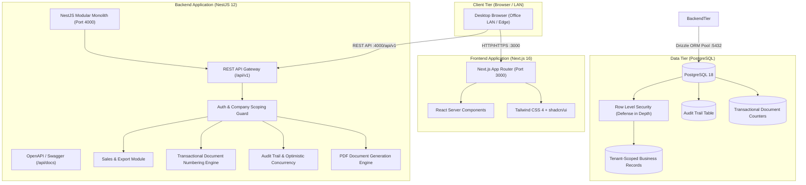

# ExportFly Web — Architecture Overview

## 1. Executive Summary

**ExportFly Web** is an enterprise-grade export management system custom-engineered for **RMM Agro Exports** (leading Indian Basmati rice exporters) and its sister companies (including **Pragati** and **Dudani**).

ExportFly Web replaces an existing mission-critical Windows desktop application that handles end-to-end export lifecycles: from Buyer Purchase Orders (PO) and Letters of Credit (LC), through Proforma Invoices (PI), Production Orders to the rice mill, Commercial Export Invoices, Container Packing Lists, and Export Documentation, down to Payment Receipts.

The web platform is architected as a **Modular Monolith** using **Next.js (React 19, TypeScript strict)** on the frontend and **NestJS (Node.js, ESM, TypeScript strict)** on the backend, backed by **PostgreSQL** via **Drizzle ORM**.

---

## 2. Core Architectural Principles

1. **Company Isolation at Every Layer**:
   Every business record strictly belongs to an authorized exporting company (`company_id`). Authorization is verified server-side on every request via typed session cookies/tokens and validated against the database. No cross-company data leakage is permitted.

2. **Transactional, Gap-Free Document Numbering**:
   Financial and customs compliance mandates strictly gap-free, duplicate-free document numbers (e.g. `PI-<CODE>/AM/<no>`, `<CODE>/<no>`, `<CODE>/EX/<FY>/<no>`). PostgreSQL sequences alone are avoided for official sequences because rollbacks create permanent gaps. Instead, a row-locked transactional document counter (`SELECT ... FOR UPDATE`) is used within the document creation transaction.

3. **Immutability of Historical Documents & Frozen Terms**:
   Terms, conditions, bank instructions, and line specifications printed on documents are permanently snapshotted at time of creation. Master data updates never retrospectively alter issued documents.

4. **Optimistic Concurrency Control**:
   All mutable entities feature a numeric `version` column. Concurrent edits are rejected with a clear `409 Conflict ("record changed")` error, preventing lost updates.

5. **Complete Audit Trail**:
   Every create, update, and soft-delete operation commits an audit record in the exact same database transaction as the business operation. Deletes are soft (`deleted_at` timestamp), retaining complete historical auditability.

6. **Server-Authoritative Financial Arithmetic**:
   Financial figures and metric tonnages are calculated exclusively on the backend using `NUMERIC` arbitrary-precision arithmetic, avoiding floating-point inaccuracies.
