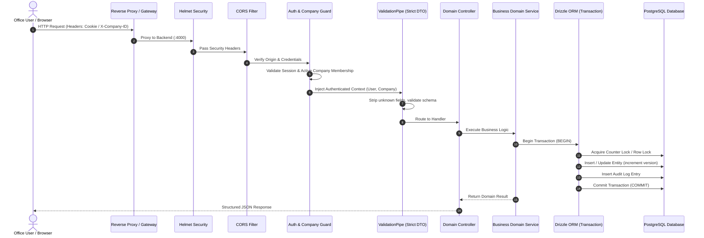

# ExportFly Web — System Design & Component Architecture

## 1. Monorepo Organization

ExportFly uses a unified pnpm workspace monorepo adhering to strict separation of concerns:

```
rmm__agro_exports/
├── apps/
│   ├── frontend/         # Next.js 16 (App Router, Tailwind CSS 4, shadcn/ui)
│   └── backend/          # NestJS 12 (ESM, REST API, Drizzle ORM)
├── packages/
│   └── shared/           # Shared types, Zod schemas, business constants, DTOs
├── docs/                 # System architecture, database, security, and ADRs
└── infrastructure/       # Docker Compose, systemd unit files, nginx LAN reverse proxy
```

---

## 2. Request Lifecycle & Middleware Pipeline



---

## 3. High-Level Subsystems

### 3.1 Authentication & Multi-Company Context
- **Session/JWT Mechanism**: Secure `HttpOnly`, `SameSite=Lax`, `Secure` cookies with signed session tokens.
- **Active Company Selection**: Upon login, user selects active exporting company (e.g., RMM Agro Exports, Pragati, Dudani). The active company context is embedded into the cryptographically verified session payload or verified against the `user_companies` authorization table.
- **Switch Company API**: Validates membership, logs audit event, and issues updated session context.

### 3.2 Transactional Document Numbering Engine
- Atomic counter increment via dedicated counter table (`document_counters`).
- Row locking with `SELECT counter FROM document_counters WHERE company_id = ? AND doc_type = ? AND financial_year = ? FOR UPDATE`.
- Guarantees zero sequence gaps and zero collisions under concurrent saves.

### 3.3 Export Workflow Engine
- Enforces strict business invariants:
  - Remaining quantity checks: Cumulative production orders cannot exceed Proforma balance.
  - Per-packing quantity aggregation: Each packaging line carries explicit bag weights and metric tons.
  - Incoterm-driven freight & insurance computations (FOB, CFR, CIF).
  - Snapshotting of terms & conditions upon issuance.

### 3.4 PDF Generation Subsystem
- Headless print-rendering engine generating pixel-perfect export documents.
- Includes company logo, bank details, standard declarations, Letter of Undertaking (LUT) lines, and optional digital signature stamps.
