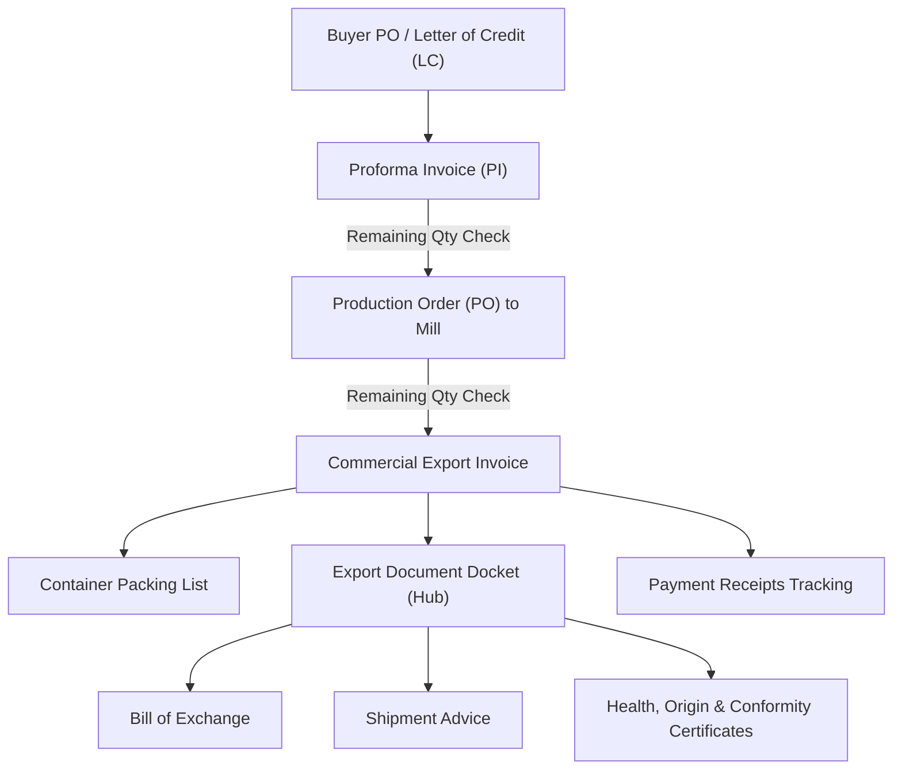

# ExportFly Web — Core Export Workflows & Strict Business Rules

## 1. End-to-End Export Workflow Chain

Every export shipment strictly adheres to the following workflow:

---

## 2. Invariant Business Rules (Strict Compliance)

### Rule 1: Per-Company Gap-Free Document Numbering
Document numbers are issued per company and document type.
- **Proforma Invoice**: `PI-<COMPANY_CODE>/AM/<number>` (e.g. `PI-RMM/AM/101`)
- **Production Order**: `<COMPANY_CODE>/<number>` (e.g. `RMM/502`)
- **Commercial Invoice**: `<COMPANY_CODE>/EX/<FY>/<number>` (e.g. `RMM/EX/26-27/045`)
- Invoices restart sequence from `1` each financial year (April 1 to March 31).
- Concurrency allocation must be transactional via row locking. PostgreSQL sequences alone are forbidden.

### Rule 2: Multi-Company Strict Scoping
- A user only ever sees and queries records belonging to their active company.
- Every API checks the active session company. Client-submitted `company_id` is never trusted.

### Rule 3: Soft Deletion
- Business records are never permanently removed from the database during regular operations.
- Soft-deleted records have `deleted_at = NOW()`. Queries filter `deleted_at IS NULL`.
- Deletion logs record the deleting user, timestamp, and mandatory deletion reason.

### Rule 4: Atomic Audit Trail
- Every Create, Update, Delete, Login, Logout, and Company Switch is logged.
- The audit record is committed in the same database transaction as the business operation.

### Rule 5: Record-Changed Protection (Optimistic Concurrency)
- When two users open the same record simultaneously, the first to save increments the `version`.
- The second user's save is rejected with `409 Conflict ("Record has been modified by another user. Please reload.")`.

### Rule 6: Frozen Terms & Conditions
- Master terms & conditions are templates.
- When an invoice or proforma is saved, the exact terms text is snapshotted into `frozen_terms`.
- Subsequent edits to master terms do not alter previously issued documents.

### Rule 7: Incoterm-Driven Shipping Charges
An invoice's shipping charges grid depends strictly on the selected Incoterm:
- **FOB (Free On Board)**: Includes THC (Terminal Handling Charge), BL (Bill of Lading fee), Seal charge, MUC (Maritime Union Charge), Risk charge, Repositioning charge.
- **CFR (Cost & Freight)**: Includes all FOB charges plus **Ocean Freight**.
- **CIF (Cost, Insurance & Freight)**: Includes all CFR charges plus **Marine Insurance**.

### Rule 8: Remaining-Quantity Allocation Checks
- Production Orders raised against a Proforma Invoice cannot exceed the unallocated balance quantity of that PI.
- Commercial Invoices raised against a Production Order cannot exceed the remaining balance quantity of that PO.
- Quantity checks are enforced client-side for UX and inside the database transaction with `FOR UPDATE` locks to eliminate race conditions.

### Rule 9: Per-Packing Quantities
- Rice shipments involve multiple bag sizes and packing styles (e.g., `30KG BOPP BAGS — 1000 MT` and `40KG NON-WOVEN — 500 MT`).
- Quantities and weights are recorded and validated per packing line, not as a flat lumped quantity.

### Rule 10: Proforma Party-Field Compatibility (Deliberate Legacy Swap)
- In the legacy Windows application database:
  - The UI field labelled **Consignee** is stored in the `customer` column.
  - The UI field labelled **Buyer** is stored in the `consignee` column.
- This mapping must be preserved identically in ExportFly Web to ensure backward compatibility with historical records.
