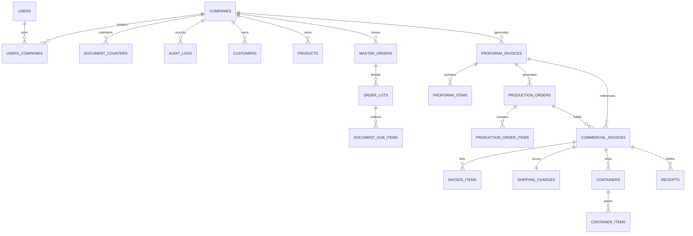

# ExportFly Web — Relational Data Model & Entity Specifications

## 1. Entity-Relationship Overview



---

## 2. Core Relational Tables & DDL Blueprint

### 2.1 Multi-Tenant Core: `companies` & `users`

```sql
CREATE TABLE companies (
    id UUID PRIMARY KEY DEFAULT gen_random_uuid(),
    code VARCHAR(16) NOT NULL UNIQUE, -- e.g. 'RMM', 'PRAGATI', 'DUDANI'
    name VARCHAR(128) NOT NULL,
    legal_name VARCHAR(255) NOT NULL,
    gstin VARCHAR(15),
    iec_code VARCHAR(32), -- Importer Exporter Code
    pan_number VARCHAR(10),
    lut_number VARCHAR(64), -- Letter of Undertaking
    ad_code VARCHAR(32), -- Authorized Dealer Code
    address_line1 VARCHAR(255) NOT NULL,
    address_line2 VARCHAR(255),
    city VARCHAR(64) NOT NULL,
    state VARCHAR(64) NOT NULL,
    country VARCHAR(64) NOT NULL DEFAULT 'India',
    pincode VARCHAR(16) NOT NULL,
    contact_phone VARCHAR(32),
    contact_email VARCHAR(128),
    logo_path VARCHAR(255),
    digital_signature_path VARCHAR(255),
    created_at TIMESTAMPTZ NOT NULL DEFAULT NOW(),
    updated_at TIMESTAMPTZ NOT NULL DEFAULT NOW()
);

CREATE TABLE users (
    id UUID PRIMARY KEY DEFAULT gen_random_uuid(),
    username VARCHAR(64) NOT NULL UNIQUE,
    email VARCHAR(128) NOT NULL UNIQUE,
    password_hash VARCHAR(255) NOT NULL,
    full_name VARCHAR(128) NOT NULL,
    role VARCHAR(32) NOT NULL DEFAULT 'ordinary_user', -- super_admin, admin, ordinary_user
    allowed_screens JSONB NOT NULL DEFAULT '[]'::JSONB, -- Array of accessible screen keys
    is_active BOOLEAN NOT NULL DEFAULT true,
    last_login_at TIMESTAMPTZ,
    created_at TIMESTAMPTZ NOT NULL DEFAULT NOW(),
    updated_at TIMESTAMPTZ NOT NULL DEFAULT NOW()
);

CREATE TABLE user_companies (
    user_id UUID NOT NULL REFERENCES users(id) ON DELETE CASCADE,
    company_id UUID NOT NULL REFERENCES companies(id) ON DELETE RESTRICT,
    is_default BOOLEAN NOT NULL DEFAULT false,
    created_at TIMESTAMPTZ NOT NULL DEFAULT NOW(),
    PRIMARY KEY (user_id, company_id)
);
```

### 2.2 Transactional Document Numbering: `document_counters`

```sql
CREATE TABLE document_counters (
    company_id UUID NOT NULL REFERENCES companies(id) ON DELETE RESTRICT,
    document_type VARCHAR(32) NOT NULL, -- 'PROFORMA', 'PRODUCTION_ORDER', 'INVOICE', etc.
    financial_year VARCHAR(16) NOT NULL, -- '2026-27' or 'ALL' for perpetual
    last_number INTEGER NOT NULL DEFAULT 0,
    prefix VARCHAR(32) NOT NULL,
    suffix VARCHAR(32) NOT NULL DEFAULT '',
    updated_at TIMESTAMPTZ NOT NULL DEFAULT NOW(),
    PRIMARY KEY (company_id, document_type, financial_year)
);
```

### 2.3 Master Documents: `proforma_invoices`, `production_orders`, `commercial_invoices`

```sql
CREATE TABLE proforma_invoices (
    id UUID PRIMARY KEY DEFAULT gen_random_uuid(),
    company_id UUID NOT NULL REFERENCES companies(id) ON DELETE RESTRICT,
    document_number VARCHAR(64) NOT NULL,
    document_date DATE NOT NULL,
    financial_year VARCHAR(16) NOT NULL,
    
    -- Business Gotcha: In existing desktop data, party labelled Consignee is stored in customer_id,
    -- and Buyer is stored in consignee_id.
    customer_id UUID NOT NULL REFERENCES customers(id), -- Displays as "Consignee" on PI
    consignee_id UUID REFERENCES customers(id),         -- Displays as "Buyer" on PI
    notify_party_id UUID REFERENCES customers(id),
    
    incoterm VARCHAR(16) NOT NULL, -- FOB, CFR, CIF
    currency VARCHAR(8) NOT NULL DEFAULT 'USD',
    exchange_rate NUMERIC(12, 4) NOT NULL DEFAULT 1.0000,
    
    port_of_loading VARCHAR(128) NOT NULL,
    port_of_discharge VARCHAR(128) NOT NULL,
    final_destination VARCHAR(128) NOT NULL,
    payment_terms TEXT NOT NULL,
    frozen_terms TEXT, -- Terms snapshotted at time of issuance
    bank_details_id UUID REFERENCES bank_details(id),
    
    total_quantity_mt NUMERIC(12, 3) NOT NULL DEFAULT 0.000,
    total_amount NUMERIC(15, 2) NOT NULL DEFAULT 0.00,
    
    status VARCHAR(32) NOT NULL DEFAULT 'DRAFT', -- DRAFT, CONFIRMED, FULFILLED, CANCELLED
    version INTEGER NOT NULL DEFAULT 1, -- Optimistic concurrency control
    deleted_at TIMESTAMPTZ, -- Soft deletion
    created_by UUID NOT NULL REFERENCES users(id),
    updated_by UUID NOT NULL REFERENCES users(id),
    created_at TIMESTAMPTZ NOT NULL DEFAULT NOW(),
    updated_at TIMESTAMPTZ NOT NULL DEFAULT NOW(),
    
    CONSTRAINT uq_pi_company_number UNIQUE (company_id, document_number)
);

CREATE TABLE production_orders (
    id UUID PRIMARY KEY DEFAULT gen_random_uuid(),
    company_id UUID NOT NULL REFERENCES companies(id) ON DELETE RESTRICT,
    document_number VARCHAR(64) NOT NULL,
    document_date DATE NOT NULL,
    proforma_invoice_id UUID NOT NULL REFERENCES proforma_invoices(id),
    buyer_po_number VARCHAR(64),
    
    supplier_mill_id UUID REFERENCES suppliers(id), -- The rice mill producing the order
    milling_instructions TEXT,
    packaging_instructions TEXT,
    dispatch_schedule DATE,
    
    total_quantity_mt NUMERIC(12, 3) NOT NULL DEFAULT 0.000,
    
    status VARCHAR(32) NOT NULL DEFAULT 'PENDING', -- PENDING, IN_PRODUCTION, COMPLETED, CANCELLED
    version INTEGER NOT NULL DEFAULT 1,
    deleted_at TIMESTAMPTZ,
    created_by UUID NOT NULL REFERENCES users(id),
    updated_by UUID NOT NULL REFERENCES users(id),
    created_at TIMESTAMPTZ NOT NULL DEFAULT NOW(),
    updated_at TIMESTAMPTZ NOT NULL DEFAULT NOW(),
    
    CONSTRAINT uq_po_company_number UNIQUE (company_id, document_number)
);

CREATE TABLE commercial_invoices (
    id UUID PRIMARY KEY DEFAULT gen_random_uuid(),
    company_id UUID NOT NULL REFERENCES companies(id) ON DELETE RESTRICT,
    document_number VARCHAR(64) NOT NULL,
    document_date DATE NOT NULL,
    financial_year VARCHAR(16) NOT NULL,
    
    proforma_invoice_id UUID REFERENCES proforma_invoices(id),
    production_order_id UUID REFERENCES production_orders(id),
    buyer_po_number VARCHAR(64),
    
    customer_id UUID NOT NULL REFERENCES customers(id),
    consignee_id UUID REFERENCES customers(id),
    notify_party_id UUID REFERENCES customers(id),
    
    shipping_bill_number VARCHAR(64),
    shipping_bill_date DATE,
    bl_number VARCHAR(64),
    bl_date DATE,
    vessel_flight_name VARCHAR(128),
    voyage_number VARCHAR(64),
    port_of_loading VARCHAR(128) NOT NULL,
    port_of_discharge VARCHAR(128) NOT NULL,
    country_of_origin VARCHAR(64) NOT NULL DEFAULT 'India',
    country_of_destination VARCHAR(64) NOT NULL,
    
    incoterm VARCHAR(16) NOT NULL,
    currency VARCHAR(8) NOT NULL DEFAULT 'USD',
    exchange_rate NUMERIC(12, 4) NOT NULL DEFAULT 1.0000,
    
    total_fob_amount NUMERIC(15, 2) NOT NULL DEFAULT 0.00,
    ocean_freight_amount NUMERIC(15, 2) NOT NULL DEFAULT 0.00,
    insurance_amount NUMERIC(15, 2) NOT NULL DEFAULT 0.00,
    total_invoice_amount NUMERIC(15, 2) NOT NULL DEFAULT 0.00,
    amount_in_words TEXT NOT NULL,
    
    lut_number VARCHAR(64),
    bank_details_id UUID REFERENCES bank_details(id),
    frozen_terms TEXT,
    
    status VARCHAR(32) NOT NULL DEFAULT 'ISSUED', -- ISSUED, NEGOTIATED, PAID, CANCELLED
    version INTEGER NOT NULL DEFAULT 1,
    deleted_at TIMESTAMPTZ,
    created_by UUID NOT NULL REFERENCES users(id),
    updated_by UUID NOT NULL REFERENCES users(id),
    created_at TIMESTAMPTZ NOT NULL DEFAULT NOW(),
    updated_at TIMESTAMPTZ NOT NULL DEFAULT NOW(),
    
    CONSTRAINT uq_inv_company_number_fy UNIQUE (company_id, financial_year, document_number)
);
```

### 2.4 Audit Trail: `activity_logs`

```sql
CREATE TABLE activity_logs (
    id BIGSERIAL PRIMARY KEY,
    company_id UUID REFERENCES companies(id) ON DELETE SET NULL,
    user_id UUID REFERENCES users(id) ON DELETE SET NULL,
    username VARCHAR(64) NOT NULL,
    action VARCHAR(32) NOT NULL, -- 'CREATE', 'UPDATE', 'DELETE', 'LOGIN', 'LOGOUT', 'SWITCH_COMPANY'
    entity_table VARCHAR(64) NOT NULL,
    entity_id VARCHAR(64) NOT NULL,
    changed_fields JSONB,
    previous_values JSONB,
    new_values JSONB,
    deletion_reason TEXT,
    ip_address VARCHAR(45),
    user_agent TEXT,
    created_at TIMESTAMPTZ NOT NULL DEFAULT NOW()
);
```
